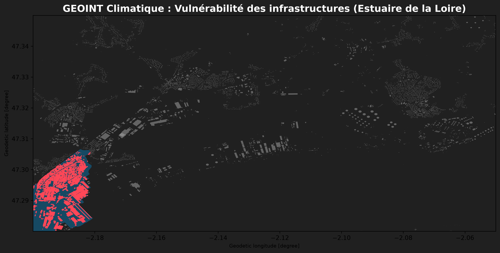

# 🌍 GEOINT & Climate Security : Analyse de vulnérabilité des infrastructures

Ce projet démontre l'utilisation des architectures Cloud-Native Geospatial pour évaluer la vulnérabilité des infrastructures industrielles face au risque de submersion marine.

## 🎯 L'objectif
Croiser des données vectorielles massives hébergées sur le cloud avec des données gouvernementales de prévention des risques, le tout exécuté en local de manière ultra-optimisée sans nécessiter de serveur de base de données lourd (architecture In-Process).

## 🛠️ Stack Technique
* **Moteur Analytique :** DuckDB (Spatial Extension)
* **Formats Modernes :** GeoParquet, GeoJSON
* **Données Cloud :** Overture Maps (Requêtage HTTP direct sur Amazon S3)
* **Traitement & Visu :** Python (GeoPandas, Matplotlib)

## 🚀 Comment ça marche ?
Plutôt que de télécharger les 200 Go de la carte mondiale d'Overture Maps, DuckDB extrait à la volée uniquement l'emprise de la zone industrielle de Donges (Estuaire de la Loire). Une jointure spatiale (`ST_Intersects`) est ensuite calculée en mémoire avec le plan de submersion de `data.gouv.fr`.

## 📊 Résultat visuel

La carte ci-dessous met en évidence les infrastructures industrielles de la zone de Donges (en gris) croisées avec les zones à risque de submersion (en bleu). Les bâtiments directement menacés ressortent en rouge.

